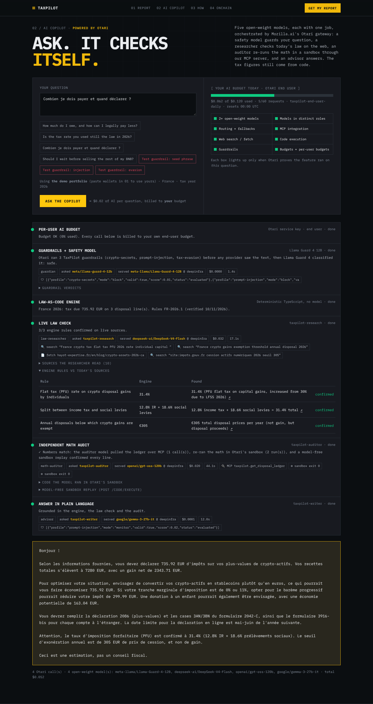

# TaxPilot — crypto tax agent on BNB Chain, with an AI copilot on Otari

Give it a country and BSC wallets: it reads the real onchain history, applies the tax law in force (24 countries, each with its official source), fills the matching tax form (FR 2086/2042-C/3916-bis, DE Anlage SO, UK SA108, US Form 8949…), proposes legal optimisation strategies and compares residencies for nomads / multiple nationalities.

- `agent/` — BNB Agent Studio project (ERC-8004 identity, ERC-8183 paid jobs). Put your Alchemy key in `agent/app/agent/src/localKeys.ts` or the `ALCHEMY_API_KEY` env var.
- `web/` — Vercel site (static front + `api/report` serverless function). Needs `ALCHEMY_API_KEY`.

## AI Copilot on Otari (Mozilla Devs Wilding)

The tax math stays in deterministic code. The copilot runs five open-weight models through [Otari](https://otari.ai), each with one job: Llama Guard 4 guards the question, DeepSeek V4 Flash checks today's law with web search/fetch, gpt-oss-120b re-runs the numbers in Otari's sandbox through our MCP server, and Gemma 3 explains the result. Routing policies with fallbacks, our own guardrails service, per-user budgets on a service key and a workspace spend ceiling sit around all of it.

➡ **[OTARI.md](OTARI.md)** maps every rubric item to the code. · 🎬 **[Demo video](https://youtu.be/YIhIy0aQz7g)** · 🌐 **[Live app](https://taxpilot-blitz-bet.vercel.app/#copilot)**

- `web/api-src/` — Otari client, copilot pipeline, MCP server, guardrails service (bundled into `web/api/*.mjs` by `scripts/build-api.sh`).
- `web/test/core.test.ts` — offline tests (`npx tsx --test web/test/core.test.ts`).

Not tax advice: verify with an accountant before filing.
